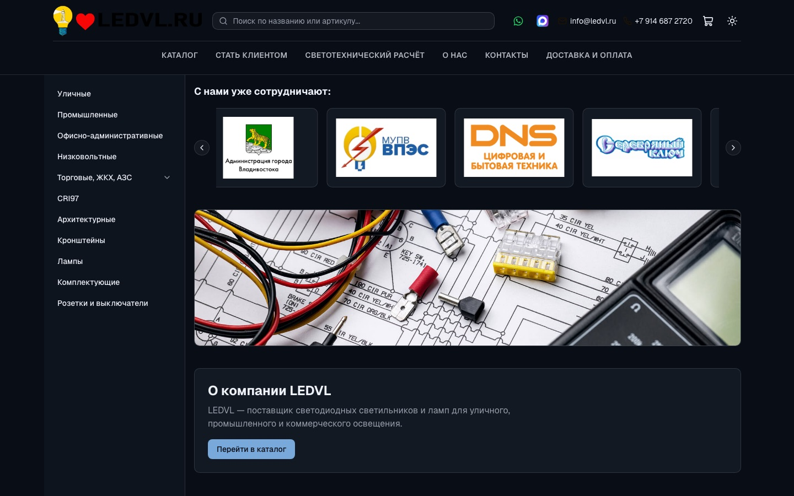
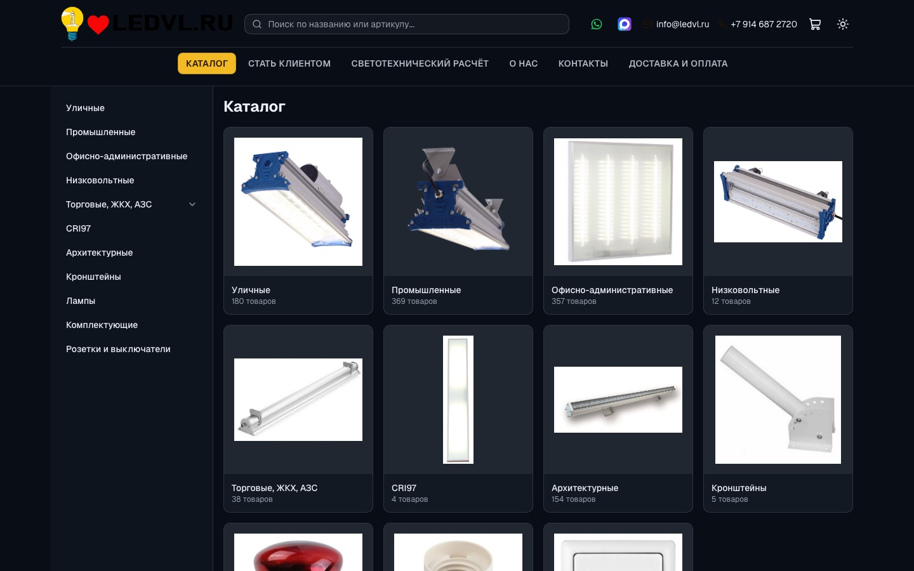
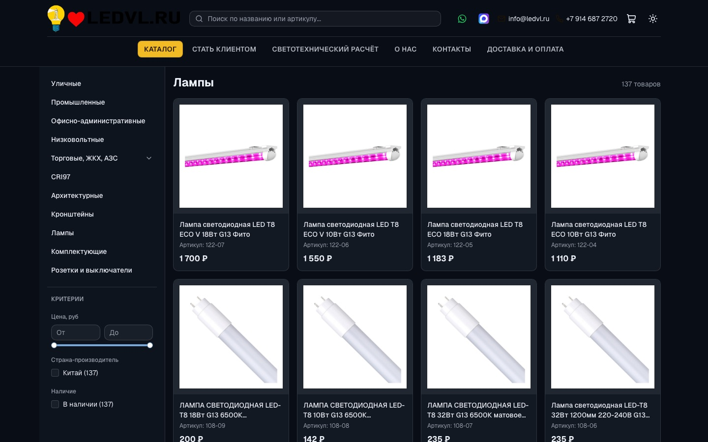
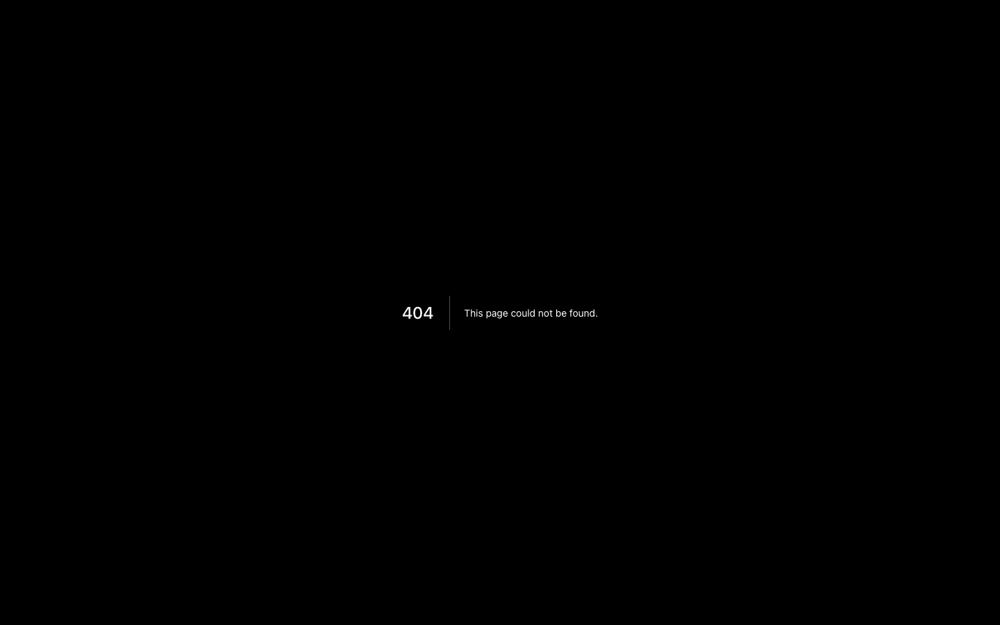
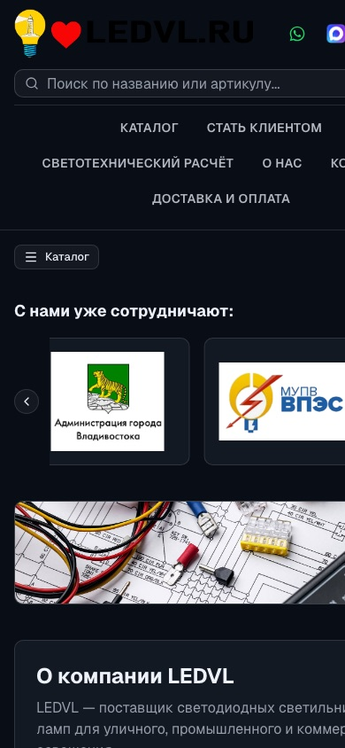

# LEDVL: lighting-equipment store on Next.js and NestJS

**Live site:** https://ledvl.ru

Catalog of LED lighting for a Vladivostok supplier: street, industrial, office, low-voltage, trade and CRI97 fixtures, with a filter engine over a loaded price list, a cart, an admin panel and an Excel import pipeline. Next.js frontend, NestJS backend, PostgreSQL, MinIO for images, Docker Compose for the whole stack.

<table>
  <tr>
    <td width="50%"></td>
    <td width="50%"></td>
  </tr>
  <tr>
    <td colspan="2"></td>
  </tr>
  <tr>
    <td></td>
    <td align="center"></td>
  </tr>
</table>

## Stack and size

| 8 730 | 44 + 28 | 9 | 3 | 8 | 9 |
| --- | --- | --- | --- | --- | --- |
| lines of TypeScript | backend + frontend files | Postgres tables | SQL migrations | TypeORM entities | API controllers under `/api/v1` |

Next.js 14.2 with React 18, Tailwind, framer-motion, react-hook-form, zustand with persisted cart, axios. NestJS 11 with TypeORM 0.3, passport-jwt, bcrypt, swagger, multer for uploads, Excel import. PostgreSQL 15 and MinIO in `docker-compose.yml`.

## How it is put together

```
backend/src/
  auth/        local strategy + bcrypt check, JWT issuing, JwtAuthGuard
  products/    catalog queries, filter engine, price-list join
  filters/     filter and filter-value CRUD used by the catalog UI
  categories/  category tree for the left rail
  import/      Excel price-list ingestion into price_list_entries
  upload/      product image upload
  storage/     S3 client against MinIO
  orders/      public order creation, admin list and status change
  cart/        server-side cart endpoint
  admin/       admin account management
  entities/    8 TypeORM entities
backend/migrations/   001-initial-schema, 002-add-filters, 003-add-featured-products
frontend/src/
  app/         pages: catalog, category, product, cart, checkout, admin, about, contacts, offer, privacy, requisites
  components/  Header, CatalogFilters, ProductCard, ProductForm, AdminFilters, ContactUs, Reviews, FAQ
  store/       zustand cart, persisted to localStorage
```

Product reads go through raw SQL with positional parameters (`$1..$n`) built from an id list, then price rows are joined from `price_list_entries` in one follow-up query. Filters use a TypeORM `QueryBuilder` with named parameters and AND semantics across filter groups, including `jsonb` spec matching with `ILIKE`. Admin mutations and order reads sit behind `JwtAuthGuard`; order creation and catalog reads are public.

## What this pass changed

The 2024 repo was published as a single commit with internal documents in the root. Before touching anything I ran the stack locally against PostgreSQL 14 and checked each item.

| Item | Before | After |
| --- | --- | --- |
| Production start | `nest build` also compiled `backend/scripts`, so output landed in `dist/src/main.js` while `npm run start:prod` launched `node dist/main`. The documented quick start failed with `MODULE_NOT_FOUND` | `tsconfig.build.json` includes only `src`, `dist/main.js` is where the script expects it |
| Checkout | The form's `onSubmit` was `console.log(data)`. The button said "Подтвердить заказ" and nothing happened, while `POST /api/v1/orders`, the `orders` table and the admin order list were all in place and permanently empty | The form posts `{items, customer_info, total}` to `/api/v1/orders`, shows the returned order number, clears the cart, and reports failures. Verified end to end in a browser: order row written, number rendered |
| Field validation | `required: true` with no error rendered anywhere, so a rejected submit was silent | Name and phone render their own messages, phone validated by digit count rather than a consecutive-digits pattern, so `+7 999 111 22 33` passes |
| Cart summary on checkout | absent | item count and total shown above the submit button |
| Internal documents | deployment runbooks and a letter addressed to the client sat in the repository root | removed; setup lives in `DEPLOYMENT.md` and this README |
| Environment template | variables documented only inside markdown | `backend/.env.example` and `frontend/.env.example` |
| History | one commit, author email not tied to a GitHub account | split into reviewable commits under the account email |

## Run it

With Docker (PostgreSQL and MinIO):

```bash
npm run install:all
cp backend/.env.example backend/.env      # set DB_PASSWORD and JWT_SECRET
docker compose up -d postgres minio
psql "$DB_URL" -f backend/migrations/001-initial-schema.sql
psql "$DB_URL" -f backend/migrations/002-add-filters.sql
psql "$DB_URL" -f backend/migrations/003-add-featured-products.sql
npm run dev
```

`npm run dev` checks Docker, waits for the database, creates it if missing and starts both apps. Frontend on http://localhost:3000, API on http://localhost:3001, Swagger on http://localhost:3001/api.

Without Docker, point `DB_HOST` and friends at a local PostgreSQL and run `npm run build && npm run start:prod` in `backend`, `npm run dev` in `frontend`. Uploads need MinIO or an S3-compatible endpoint; everything else runs without it.

Seed demo products: `npm run seed:products` in `backend`. Create or reset the admin login: `npm run update:admin`.

## Known limits

- The deployed site still completes orders through the WhatsApp deep link in the cart; the API order flow fixed here is not yet released to production.
- The cart lives in `localStorage`, so it is per browser and not shared between devices.
- The admin token is kept in `localStorage` and attached by an axios interceptor, which is readable from any XSS on the admin page.
- No payment provider, no stock reservation, no email notification on new orders.
- The local development database contains two tables, `works` and `site_content`, that no entity or migration references; they are leftovers from an abandoned iteration and are not part of this schema.
- Product data and client logos on the live site belong to the business.

## Коротко по-русски

Каталог светодиодного освещения для владивостокского поставщика: Next.js 14, NestJS 11, PostgreSQL, MinIO, всё в docker-compose. Фильтры собираются по загруженному прайс-листу, товары читаются сырым SQL с позиционными параметрами и отдельным джойном цен, админские методы под JWT. В этом запуске я поднял проект локально и нашёл два живых дефекта: `npm run start:prod` падал, потому что `nest build` захватывал `backend/scripts` и клал результат в `dist/src/main.js`, а форма оформления заказа вообще не отправляла данные, хотя эндпоинт, таблица и админский список заказов были готовы и пустовали. Оба починены и проверены в браузере до строки в базе. Внутренние служебные документы и переписку с клиентом из корня убрал, переменные окружения вынесены в `.env.example`. На проде заказ по-прежнему уходит в WhatsApp, API-путь пока не выложен.

## Rights

© 2026 Nikita Koreshkov. Portfolio piece, all rights reserved. The LEDVL name, product data, client logos and contacts belong to the business.
